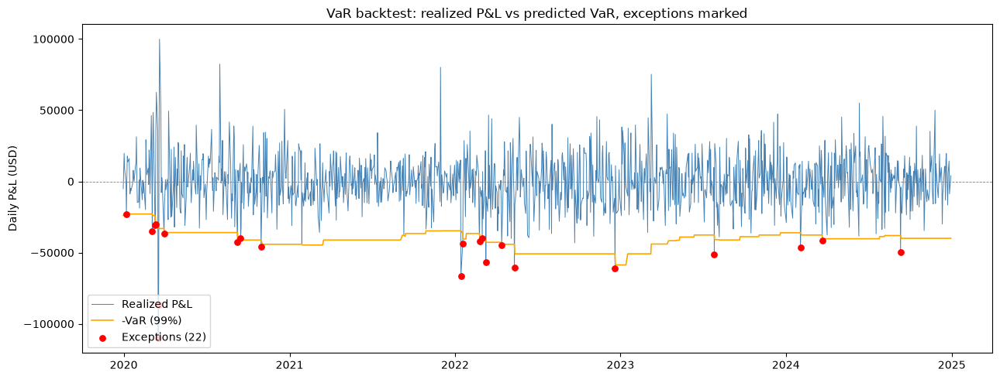

# Market-risk VaR engine

Measure portfolio losses, Value at Risk, Expected Shortfall and model calibration for a fixed-notional multi-asset book.

**Historical 99% VaR had 22 exceptions over 1,258 days versus 12.6 expected; Kupiec p = 0.016.** The real-data backtest rejects the target exception frequency despite a green scaled traffic light.



## Quick start

Run the offline unit tests from the repository root:

```bash
python3 -m venv .venv
.venv/bin/pip install -r requirements-dev.txt
.venv/bin/python -m pytest -q
```

`python -m src.explore` downloads adjusted Yahoo Finance prices. Notebooks run in `day1`–`day5` order with Jupyter/nbconvert; the saved outputs use real data. Their synthetic fallback remains in the code: always check the printed source marker before interpreting a rerun. Market data are not redistributed here; use the downloader under the provider's terms.

## Method

- AAPL, JPM and SPY equities, FXE/FXY currency ETF proxies and TLT rates proxy; daily prices from 2019–2024.
- Linear P&L combines signed notionals and log returns.
- Historical, normal parametric and covariance-based Monte Carlo VaR; historical Expected Shortfall.
- Rolling 99% historical backtest uses preceding observations only.
- Kupiec POF checks exception frequency; traffic-light counts are scaled to a 250-day equivalent.
- Illustrative FRTB P&L attribution uses Spearman correlation and the two-sample KS statistic.

## Results

The [saved consolidated report](notebooks/day5_consolidated_report.ipynb) records these real-data values.

| One-day 99% risk measure | USD, rounded |
|---|---:|
| Historical VaR | 42,438 |
| Parametric VaR | 41,017 |
| Monte Carlo VaR | 41,130 |
| Historical Expected Shortfall | 56,988 |

The full-factor attribution model was green; the incomplete model was amber. These are educational classifications, not regulatory approval.

## What didn't work

Historical VaR underestimates exception frequency. Normal models can miss heavy tails; ETF proxies and linear P&L omit nonlinear and execution risks. **Christoffersen independence testing is not implemented.** Traffic-light scaling does not resolve the rejected Kupiec result.

## Tests, structure and licence

[](https://github.com/VChahar1/market-risk-var-engine/actions/workflows/tests.yml)

Seven pytest tests pass, covering risk measures, calibration and attribution. `src/` contains reusable calculations, `tests/` contains controlled checks, and `notebooks/` contains the ordered study. `scripts/export_chart.py` extracts the existing backtest image without rerunning notebooks. Code: [MIT](LICENSE).
